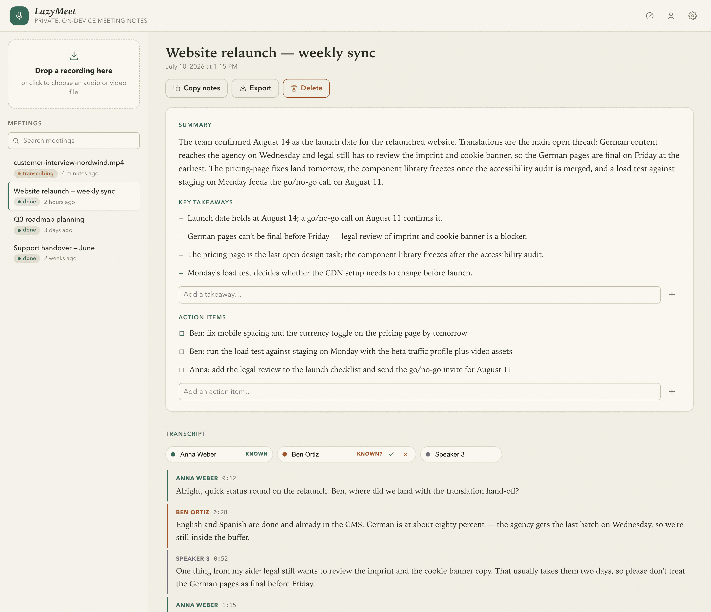
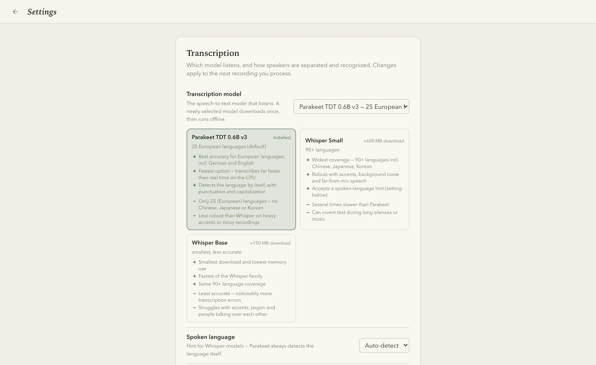
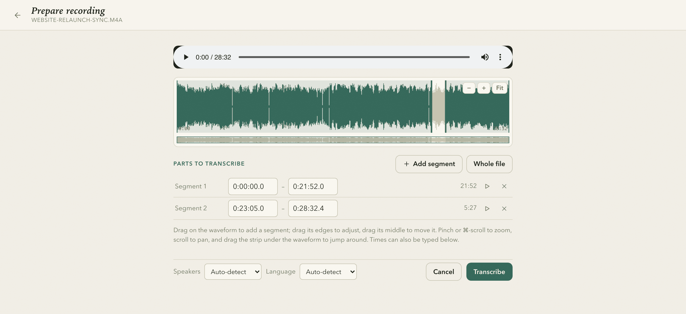

# LazyMeet

[](https://github.com/krecks/LazyMeet/actions/workflows/build.yml)
[](LICENSE)

**Local, private meeting transcription & summaries.** Drag and drop a recording
(e.g. an OBS capture) and get a **per-speaker transcript**, a **summary**, and
**action items** — everything runs on your machine. No cloud, no accounts, **no
API keys**.

Speaker identification is built in: name a speaker once and that name
**auto-applies to the same voice in future recordings**, backed by a local
voiceprint library that learns from every confirmed match.

<picture>
  <source media="(prefers-color-scheme: dark)" srcset="docs/screenshots/meeting-dark.png">
  
</picture>

## How it works

```
Tauri desktop app — one binary, everything in Rust
     1. ffmpeg (bundled)        → 16 kHz mono audio
     2. sherpa-onnx VAD         → speech utterances
     3. NVIDIA Parakeet (ONNX)  → transcript with timestamps
     4. sherpa-onnx diarization → who-spoke-when
     5. speaker identification  → match/name voices via a saved speaker library
     6. llama.cpp (in-process)  → summary, takeaways, action items
```

sherpa-onnx and llama.cpp are linked statically into the app; ffmpeg ships as
a bundled static binary. Progress streams to the UI as native events.

All AI models are **token-free** and download once on first run, then run
fully offline:

| Component | Model | Source |
|---|---|---|
| Transcription | NVIDIA parakeet-tdt-0.6b-v3 (25 European languages; Whisper Small/Base selectable) | sherpa-onnx GitHub releases |
| Voice activity | Silero VAD | sherpa-onnx GitHub releases |
| Diarization + speaker ID | pyannote-seg + speaker-embedding (ONNX) | sherpa-onnx GitHub releases |
| Summarization | Qwen 3.5 (0.8B–9B selectable, GGUF) via llama.cpp | Hugging Face (ungated) |
| ffmpeg | static binary | bundled with the app |

Models are switched in Settings — each option lists its trade-offs and
downloads on demand:



## Install (end users)

1. Download the installer for your OS from the
   [latest release](https://github.com/krecks/LazyMeet/releases/latest)
   (`.dmg`/`.app`, `.msi`/`.exe`, or `.AppImage`/`.deb`).
2. Launch **LazyMeet**. On first run it downloads the AI models (a few GB) with a
   progress screen — this happens once.
3. Drag a recording onto the window. Watch the stages, then read the transcript
   and summary. Rename `Speaker 1/2/3` to real names; those names are remembered
   and auto-applied to the same voices next time.

You install nothing else — ffmpeg, the models, and the LLM are all bundled or
auto-downloaded.

## Prepare a recording before transcribing

Every file you add opens a preparation screen first: play the recording,
see its waveform, and choose which parts get transcribed — drag directly on
the waveform to skip a break or transcribe only the segments that matter. You
can also fix the number of speakers and hint the spoken language. The whole
file is preselected, so the fast path stays a single click on **Transcribe**.



## Speaker naming across files

Diarization numbers speakers per file (Speaker 1 here ≠ Speaker 1 next time).
When you rename a speaker, LazyMeet saves that person's **voiceprint** to a local
**speaker library** (`speakers.json` in the app-data folder). On every future
upload, each detected speaker is matched against the library by voice similarity;
known voices are auto-labelled with a *known?* badge asking you to verify the
match, unknown ones stay `Speaker N` until you name them.

Auto-matches are treated as unverified until you act on the badge: confirming
(✓) adds that recording's voice as another sample for the person — up to ten
samples are averaged, so recognition **learns from every file you confirm**
and gets better across microphones and rooms. Rejecting (✗) unlinks the name
without touching the saved voiceprint, so a wrong match can't poison the
library; the speaker reverts to `Speaker N`, ready to be renamed to the right
(or a brand-new) person. Correcting a wrong match by typing over the name has
the same safe behavior. If wrong names still appear, raise **Voice match
strictness** in Settings; lower it if familiar voices go unrecognized. Manage
saved voices in the **Known speakers** panel.

## Performance

Measured on a real 28.5-minute, 1.23 GB OBS recording (HEVC 1728×1122@60,
167 transcript segments, full notes produced) on an **Apple M1 Pro with the
default settings** (7 CPU threads: ~75 % of cores). End to end the recording
processes in **~3.2 minutes — about 9× faster than realtime**, twice as fast
as v0.1.2, thanks to two pipeline changes:

- **Transcription and diarization run concurrently.** They read the same
  decoded audio with disjoint models, so each gets half the thread budget
  and they run side by side — measurably faster than either full-budget
  ordering (a 28.5-minute meeting: 190 s overlapped vs 271 s sequential).
- **Diarization is multi-threaded.** Upstream sherpa-rs pins the diarization
  models to one ONNX thread; a vendored copy (`crates/vendor/sherpa-rs`)
  exposes the thread count, which alone makes the stage 2× faster
  (229 s → 122 s on the recording above).

Stage durations on that recording, before → after:

| Stage | v0.1.2 (sequential) | now |
|---|---|---|
| Transcription (Parakeet) | 103 s | 172 s combined — the two run |
| Diarization | 229 s | concurrently on half the threads each |
| Speaker ID | 7.7 s | 7.8 s |
| Summarization (Metal GPU) | 33 s | 33 s |
| **Total** | **375 s** | **190 s** |

**Backends:** the ONNX models always run on the **CPU** — CoreML/ANE was
re-measured with the multi-threaded diarizer and is still slower on every
stage (onnxruntime can only place a fraction of the ops on the Neural
Engine, and the CPU↔ANE hand-offs cost more than the acceleration saves).
The summarizer LLM runs on the **GPU** where llama.cpp supports it (the
*Hardware acceleration* setting toggles this): Metal generates ~25 % faster
than CPU and loads the model far faster.

Hardware differs, so the app includes a built-in benchmark (gauge icon, top
right) that measures ASR, diarization, speaker ID, and the summarizer on
your machine across the available backends. Power users can also force an
ONNX execution provider with `LAZYMEET_ONNX_PROVIDER` (default `cpu`).

## Privacy

Audio, transcripts, summaries, and voiceprints never leave your machine. They
live in the OS app-data directory (`~/Library/Application Support/LazyMeet`,
`%LOCALAPPDATA%\LazyMeet`, or `~/.local/share/LazyMeet`). After the one-time model
download the app needs no network at all. The recording's audio is kept on
disk (locally, next to the transcript) so you can replay transcript sections —
video uploads are reduced to their audio track during processing, so the bulky
video itself never sticks around. Turn **Keep recording audio** off in Settings
(or set `LAZYMEET_KEEP_AUDIO=0`) to delete each recording as soon as
processing finishes instead.

## Development / building from source

Requirements: Rust (stable) + Tauri CLI (`cargo install tauri-cli --version
"^2"`), cmake (sherpa-onnx and llama.cpp build from source), and the platform
webview libs (Linux: `libwebkit2gtk-4.1-dev`).

```bash
# 1. Fetch the bundled ffmpeg for your platform (once)
./scripts/fetch_ffmpeg.sh

# 2. Run the desktop app (dev) — LAZYMEET_FAKE=1 skips the heavy models
cd src-tauri && cargo tauri dev
# ...or build installers:
cd src-tauri && cargo tauri build
```

The workspace has two crates: `crates/lazymeet-core` (config, storage, model
downloads, job queue, the ML pipeline — no Tauri dependency) and `src-tauri`
(the desktop shell: thin Tauri commands + events over core).

On Linux, static sherpa-onnx needs
`RUSTFLAGS="-C relocation-model=dynamic-no-pic"` (CI sets it).

### CLI (process a file without the app)

`lazymeet-cli` runs the full pipeline from the terminal against the same
models and prints the meeting JSON — useful for debugging and benchmarks:

```bash
cargo run --release -p lazymeet-core --bin lazymeet-cli -- recording.mp4
```

### Tests

The behavioral test suite covers the whole backend surface — meetings,
speaker library, config, model downloads, events, and the on-disk data
format. It runs against the stubbed (`LAZYMEET_FAKE`) pipeline and needs no
models or cmake:

```bash
cargo test -p lazymeet-core --no-default-features
```

### Cross-platform builds

`.github/workflows/build.yml` runs the core test suite, then builds installers
for macOS, Windows, and Linux via a CI matrix (Tauri can't cross-compile) and
uploads them as artifacts.

## Configuration

Environment variables (all optional):

| Var | Default | Purpose |
|---|---|---|
| `LAZYMEET_DATA_DIR` | OS app-data dir | Where models + transcripts live |
| `LAZYMEET_SPEAKER_THRESHOLD` | `0.6` | Voice-match strictness (cosine) |
| `LAZYMEET_MERGE_THRESHOLD` | `0.6` | Voiceprint similarity at which over-split diarized labels merge |
| `LAZYMEET_MIN_SPEAKER_SECONDS` | `15` | Speakers with less speech fold into the closest main voice |
| `LAZYMEET_NUM_THREADS` | ~75% of cores | ONNX/LLM CPU threads |
| `LAZYMEET_ASR_URL` / `LAZYMEET_LLM_URL` / … | release URLs | Override model downloads |
| `LAZYMEET_KEEP_AUDIO` | `1` | `1` = keep only the audio track for playback (video files are deleted after processing); `0` = delete recordings entirely (disables segment playback) |
| `LAZYMEET_FAKE` | unset | `1` = stubbed pipeline for dev/tests |

## Contributing

LazyMeet is young and still has rough edges — bug reports, feature ideas, and
pull requests are all welcome. Open an issue to discuss bigger changes first.
For code changes, `cargo test -p lazymeet-core --no-default-features` must
pass; the frontend is plain HTML/CSS/JS with no build step.

## License

LazyMeet is free software, released under the
[GNU General Public License v3.0 (or later)](LICENSE). You may use, study,
share, and modify it; if you distribute LazyMeet or a modified version, you
must make the source available under the same license.

The bundled ffmpeg binary is a separate program invoked by the app and remains
under its own LGPL/GPL license. The AI models are downloaded at first run
directly from their publishers and keep their respective licenses (Parakeet:
CC-BY-4.0, Qwen: Apache-2.0).
